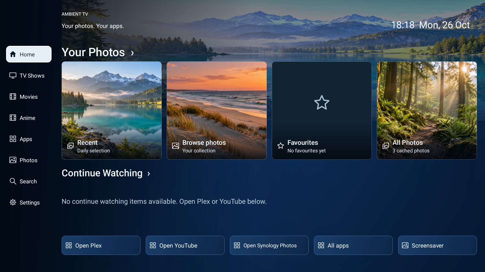
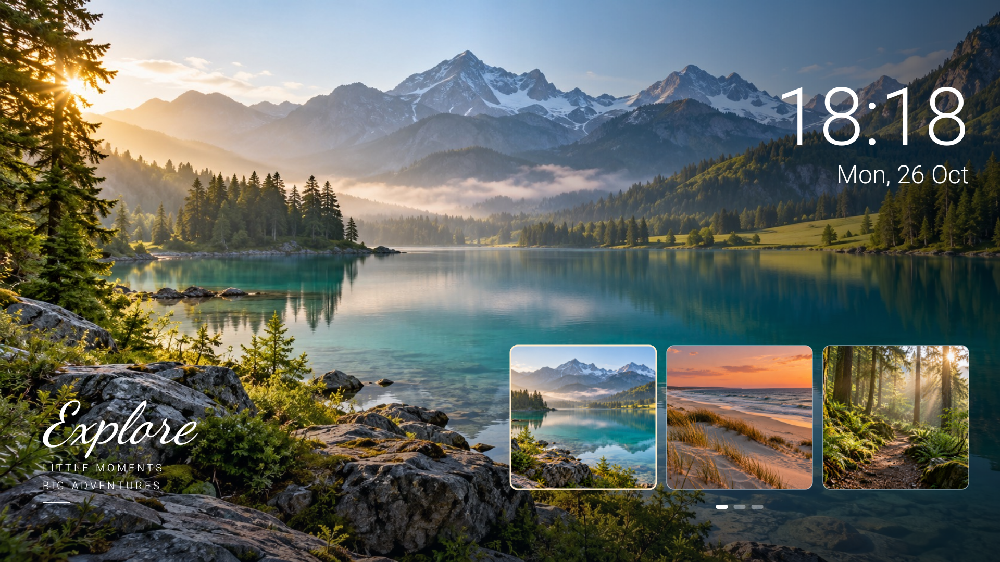
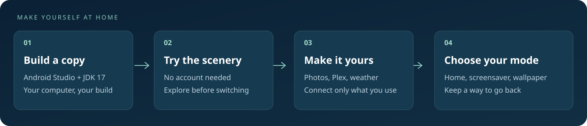

<div align="center">

# Ambient TV

### Your photos. Your apps. A calmer TV.

A photo-first home screen and screensaver for Android TV, with optional Synology Photos, Plex and weather.

[Download releases](https://github.com/TheLaughingGod1986/ambient-tv/releases) · [Get started](docs/SETUP.md) · [Copy a setup prompt](prompts/README.md) · [Troubleshooting](docs/TROUBLESHOOTING.md) · [Privacy](docs/PRIVACY.md)



</div>

**Try it without an account.** Ambient TV opens with three bundled scenery photos.
Connect your own services when you are ready. No subscription to Ambient TV, cloud
photo upload or API key is required. Your existing services may have their own terms.

> **Early preview:** this is a community project, not a store-ready replacement for
> every TV. Build and try the demo before changing your default Home app. Android
> versions, manufacturer Home buttons and media integrations behave differently.

## What you get

- **Photos above your apps.** A simple sidebar, photo collection, favourites and quick app shortcuts.
- **A photo screensaver.** A large image, matching backdrop, clock and small previews; classic multi-photo layouts are available too.
- **Old memories and new pictures.** For a chosen person in Synology Photos Personal Space, a bounded pool mixes recent photos with older memories. Cached photos stay available offline.
- **Continue Watching.** Read eligible Android TV records and optionally connect Plex for real progress and server-provided next episodes. Hold OK on a card to hide it locally.
- **Optional weather.** Choose a place yourself. Weather starts switched off; the clock uses your TV's time zone.
- **Optional Projectivy integration.** Use the photos as a wallpaper provider instead of making Ambient TV your Home app.



*These images are generated-scene demo renders from the Android app's production
views on an emulator. They contain no personal photos or account history. Weather
and media accounts are not connected. They are not photographs of a household TV.*

## New in 0.2.2

Compact mode now gives the content the space beside the narrow rail. Navigation expands over it with a translucent navy panel and a short transition; photos and controls stay fixed. Android’s disabled-animation preference is respected.

## New in 0.2.1

- More breathing room between the sidebar and content.
- Optional compact sidebar: labels appear on focus, with no content reflow. Enable it in Settings → Status & backup. Labelled navigation remains the default.

## New in 0.2

- Source status distinguishes a successful Home refresh from stale YouTube-published records.
- Choose full-photo or cinematic framing, with optional saved per-photo adjustments.
- Export and restore a credential-free preferences file.
- Signed releases and automated TV navigation checks. See [updates and recovery](docs/RELEASES.md).

## Start here



1. **Build the app.** Open this folder in Android Studio, use JDK 17 and install Android SDK 35. Or run `./gradlew :app:assembleDebug` in a terminal. On Windows use `gradlew.bat`.
2. **Install and try the demo.** Connect your TV with ADB, then run `adb -s YOUR_TV_SERIAL install -r app/build/outputs/apk/debug/app-debug.apk`. Open **Ambient TV Photos** in the TV's app list, then choose **Preview Ambient TV**.
3. **Make it yours.** Optionally connect Synology Photos and Plex. Choose Ambient TV in your TV's Home or screensaver settings when you are happy with the demo.

New to Android tools? The [illustrated setup guide](docs/SETUP.md) explains each step,
including how to go back. Prefer help from a coding assistant? Use the
[plain-language prompts](prompts/README.md).

## What you need

| To use… | You need… |
| --- | --- |
| Demo Home and screensaver | An Android TV device, remote, and a computer to build/install the app |
| Your own photo collection | Synology Photos Personal Space with a named person under People, and a NAS account allowed to view those photos |
| Plex progress and next episodes | Plex on the TV, an accessible Plex server, and a separate authorization for Ambient TV |
| YouTube Continue Watching | The native YouTube TV app publishing eligible records to Android TV |
| Wallpaper provider | A compatible Projectivy installation; check its current feature availability |
| Weather | Internet access and a place label plus coordinates you choose |

The app's minimum SDK is 23. The Android Watch Next integration requires API 26+.
The generic build is checked on an API 35 emulator; physical-TV compatibility
is still being collected. YouTube may publish old or incomplete records even
when in-app History is current. Ambient TV cannot turn unpublished history into
resume cards. Plex only uses the profile authorized for Ambient TV; it does not
automatically follow a profile switch in the native player.

## For people who want to tinker

```sh
./gradlew :app:assembleDebug :app:assembleDebugAndroidTest :app:testDebugUnitTest :app:lintDebug
python3 scripts/check-public.py
```

[How the code fits together](docs/DEVELOPMENT.md) · [Current verification](docs/VERIFICATION.md)
· [Asset provenance](docs/ASSETS.md) · [Contributing](CONTRIBUTING.md)

Licensed under [Apache 2.0](LICENSE). Third-party credits are in [NOTICE](NOTICE).
Ambient TV is independent of Android, Google, Synology, Plex and Projectivy.
